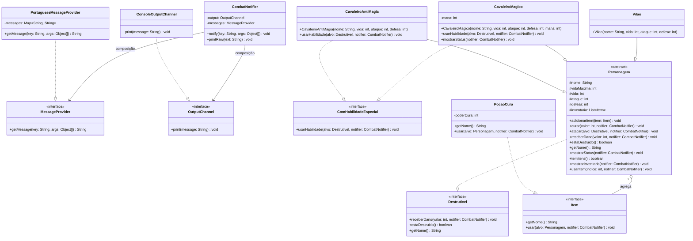

# 🍀 RPG Black Clover - Terminal Edition

[](https://www.oracle.com/java/)
[]()
[]()

Um RPG interativo em modo console baseado no universo do anime/mangá **Black Clover**, desenvolvido em Java. Este projeto foi concebido como **Atividade Prática da disciplina de Paradigmas de Programação**, com o objetivo de demonstrar a aplicação rigorosa dos conceitos de **Programação Orientada a Objetos (POO)** e dos **5 Princípios SOLID**.

---

## 📋 Sumário
- [🎮 Sobre o Jogo](#-sobre-o-jogo)
- [🛠️ Pré-requisitos e Como Rodar](#️-pré-requisitos-e-como-rodar)
  - [Compilação via Terminal](#compilação-via-terminal)
  - [Execução em IDEs](#execução-em-ides)
- [🏗️ Arquitetura e Princípios SOLID Aplicados](#️-arquitetura-e-princípios-solid-aplicados)
- [📊 Diagrama de Classes UML](#-diagrama-de-classes-uml)
- [📸 Demonstração de Execução](#-demonstração-de-execução)
- [👤 Autor](#-autor)

---

## 🎮 Sobre o Jogo

Neste RPG de combate por turnos no console, o jogador escolhe um Cavaleiro Mágico do Reino Clover para enfrentar o poderoso chefe **Vetto (Olho do Sol da Meia-Noite)**.

### Mechanics & Destaques:
* **Personagens Jogáveis:**
  * **Asta (Cavaleiro Anti-Magia):** Focado em dano físico bruto, alta defesa e na habilidade *Corte Divisor de Demônios*, que causa dano massivo sem consumir mana.
  * **Yuno (Cavaleiro Mágico):** Focado em ataques mágicos à distância com *Magia de Vento: Tormenta*, utilizando e gerenciando uma reserva de **Mana**.
* **Sistema de Atributos:** Cada entidade possui **Vida (HP)**, **Ataque (ATK)** e **Defesa (DEF)**, sendo que a defesa mitiga diretamente o dano recebido.
* **Sistema de Inventário e Itens:** O jogador conta com itens consumíveis em combate, como **Poções de Cura**, permitindo estratégias de recuperação durante a batalha.

---

## 🛠️ Pré-requisitos e Como Rodar

### Pré-requisitos
* **Java Development Kit (JDK):** Versão 11 ou superior instalada.
* **Git:** Para clonar o repositório (opcional).

### Compilação e Execução via Terminal

1. **Clone o repositório:**
   ```bash
   git clone https://github.com/Gabrielhifi/rpg-black-clover-poo.git
   cd rpg-black-clover-poo
   ```

2. **Compile o código fonte:**
   ```bash
   javac Main.java
   ```

3. **Execute a aplicação:**
   ```bash
   java Main
   ```

### Execução via IDE (VS Code / IntelliJ / Eclipse)
1. Abra a pasta do projeto na sua IDE de preferência.
2. Certifique-se de que o SDK configurado é o **Java 11+**.
3. Localize o ficheiro `Main.java`.
4. Clique em **Run** / **Debug** (ou pressione `Shift + F10` no IntelliJ / `F5` no VS Code).

---

## 🏗️ Arquitetura e Princípios SOLID Aplicados

O projeto evita o acoplamento excessivo e a criação de "classes anêmicas", separando claramente as responsabilidades de entrada/saída, internacionalização e regras de domínio.

### 1. SRP — Single Responsibility Principle (Princípio da Responsabilidade Única)
* **Aplicação:** A classe abstrata `Personagem` gerencia apenas o estado e as regras de combate dos personagens. Toda a exibição de dados no console e a formatação das mensagens foram delegadas às interfaces `OutputChannel` (saída) e `MessageProvider` (internacionalização), intermediadas pela classe `CombatNotifier`.
* **Benefício:** Mudanças na forma como o jogo imprime informações ou no idioma das mensagens não afetam a regra de negócio do combate.

### 2. OCP — Open/Closed Principle (Princípio Aberto/Fechado)
* **Aplicação:** O sistema de itens (interface `Item`) e o sistema de mensagens (`MessageProvider`) estão abertos para extensão, mas fechados para modificação.
* **Benefício:** Para criar novos itens (ex: *Elixir de Mana*, *Escudo Mágico*) ou novos idiomas (ex: *Inglês*), basta criar novas classes que implementem `Item` ou `MessageProvider`, sem alterar nenhuma linha do código de combate existente.

### 3. LSP — Liskov Substitution Principle (Princípio da Substituição de Liskov)
* **Aplicação:** As subclasses `CavaleiroAntiMagia`, `CavaleiroMagico` e `Vilao` podem substituir a classe base `Personagem` em qualquer ponto da aplicação sem quebrar o comportamento esperado.
* **Benefício:** O motor de combate trata todos os envolvidos genericamente como `Personagem` ou `Destrutivel`, garantindo polimorfismo seguro.

### 4. ISP — Interface Segregation Principle (Princípio da Segregação de Interface)
* **Aplicação:** Em vez de forçar todos os personagens a possuírem métodos de magia ou itens, as responsabilidades foram segregadas nas interfaces `ComHabilidadeEspecial`, `Destrutivel` e `Item`.
* **Benefício:** A classe `Vilao` não precisa implementar métodos de mana ou habilidades especiais de cavaleiro que não utiliza.

### 5. DIP — Dependency Inversion Principle (Princípio da Inversão de Dependência)
* **Aplicação:** O método `atacar()` da classe `Personagem` não depende de uma implementação concreta, mas sim da abstração `Destrutivel`. Da mesma forma, `CombatNotifier` depende das interfaces `OutputChannel` e `MessageProvider`.
* **Benefício:** Permite que personagens ataquem qualquer elemento destrutível do jogo (como baús, portas ou barreiras mágicas) sem necessidade de reescrever o método de ataque.

---

## 📊 Diagrama de Classes UML

O diagrama abaixo representa a estrutura de classes, interfaces e relacionamentos do projeto:



---


Paradigmas: Orientação a Objetos (POO)


Desenvolvido como estudo de Paradigmas da programação.
